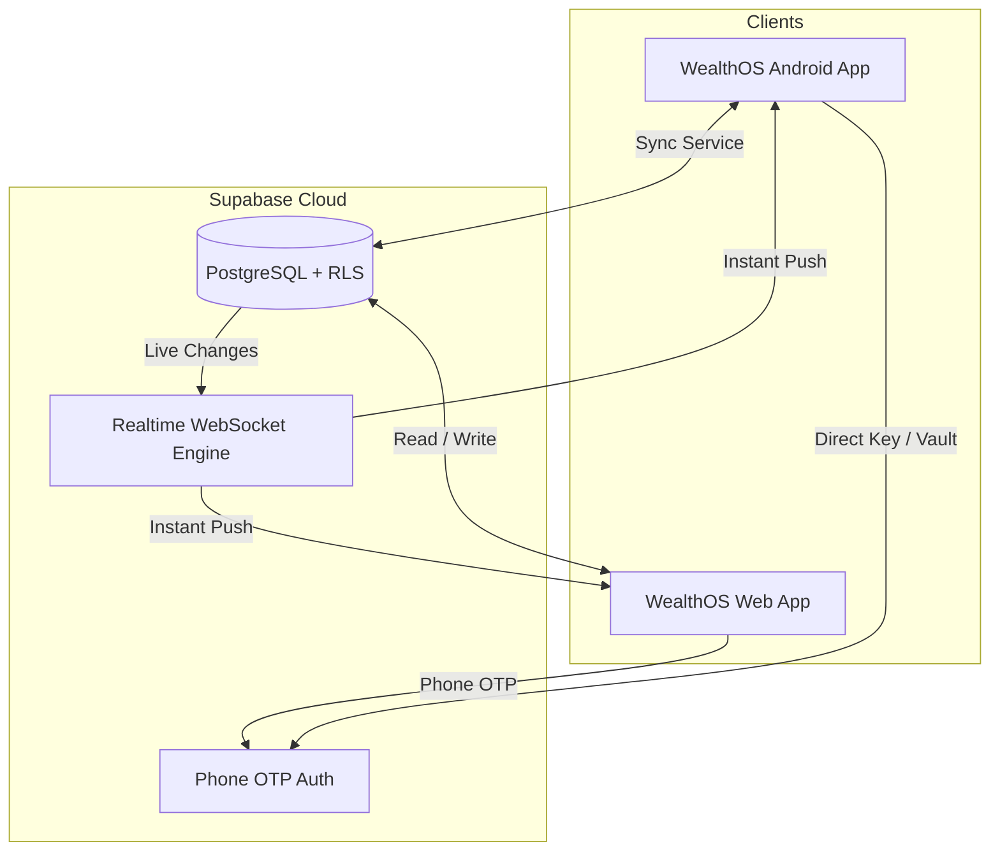

# WealthOS Web & Synchronization Deployment Guide

WealthOS Web is a premium, real-time companion web application for WealthOS Android. Both apps share a unified Supabase cloud database with end-to-end security, instant bidirectional sync, and local-first resilience.

---

## 1. Architecture Overview



- **Database**: PostgreSQL on Supabase with Row Level Security (RLS) guaranteeing user data isolation.
- **Sync**: Supabase Realtime pushes database change notifications instantly over WebSocket to all open devices.
- **Offline / Local Resilience**: WealthOS Web caches data in `localStorage` and falls back gracefully with seed data if offline.
- **Export / Import**: Direct cross-platform JSON import/export is supported between Android and Web.

---

## 2. Supabase Database Setup

1. Open your [Supabase Dashboard](https://supabase.com/dashboard) and go to your project (`https://zahzagnindkkttdpmqii.supabase.co`).
2. Go to **SQL Editor** in the left sidebar.
3. Open or copy the contents of `supabase/migrations/20261014000000_web_sync.sql`:
   - Creates `user_accounts`, `user_categories`, `user_transactions`, `user_journal_entries`, `user_goals`, `user_debts`, `user_chit_funds`, `user_recurring_transactions`, `user_budgets`, `user_settings`, `user_notifications`.
   - Enables Row Level Security (RLS) on all tables.
   - Adds tables to `supabase_realtime` publication for instant synchronization.
4. Click **Run** to execute the migration.

### Phone OTP Auth Setup (Optional for SMS Delivery):
- In Supabase Dashboard, go to **Authentication** → **Providers** → **Phone**.
- Enable Phone provider and select your SMS gateway (Twilio, MessageBird, Vonage, or Test OTP).
- *Note:* If SMS provider is not yet configured, the web application includes built-in development fallback where entering test code `123456` or clicking **"Instant Demo / Guest Access"** allows full testing immediately.

---

## 3. Free Deployment to Render.com

Render offers free hosting for static web applications with global CDN and automated SSL.

### Step 1: Connect GitHub Repository
1. Log in to [Render.com](https://render.com).
2. Click **New +** → **Static Site**.
3. Select your repository (`WealthOS`).

### Step 2: Configure Build Settings
Fill in the following fields:
- **Name**: `wealthos-web` (or any custom name)
- **Branch**: `master` (or your active branch)
- **Root Directory**: `wealthos-web`
- **Build Command**: `npm install && npm run build`
- **Publish Directory**: `dist`

### Step 3: Add Environment Variables
Under **Environment Variables**, add:
- `VITE_SUPABASE_ANON_KEY`: *(Your Supabase anon public key from Project Settings → API)*

*(The project URL `https://zahzagnindkkttdpmqii.supabase.co` is preconfigured).*

### Step 4: Configure SPA Rewrite Rule (Automatic via `public/_redirects`)
WealthOS Web includes `public/_redirects` which handles client-side routing on Render:
```
/* /index.html 200
```
Render automatically detects this file and routes all URLs (`/accounts`, `/insights`, `/plans`, etc.) to `index.html`.

### Step 5: Click "Create Static Site"
Render will build the Vite app and assign you a free HTTPS URL:
`https://wealthos-web.onrender.com`

---

## 4. Running WealthOS Web Locally

```bash
cd wealthos-web

# Install dependencies
npm install

# Start local development server with hot reload
npm run dev

# Open in browser at http://localhost:5173
```

To create a production build and test the bundle locally:
```bash
npm run build
npm run preview
```

---

## 5. Mobile & Web Synchronization Verification

1. **Sign in on Web**:
   - Navigate to the web app URL.
   - Enter your mobile number, or click "Instant Demo / Guest Access".
2. **Add a Transaction or Account on Web**:
   - Press `Ctrl + K` or click **New Transaction**.
   - Fill in amount, category, and account.
   - Notice the transaction immediately persists to Supabase and updates account balances.
3. **Android Reflection**:
   - The Android app receives the new record via `CloudSyncService` or background sync.
   - In Settings, click **"Sync Cloud"** or **"Import Backup"** anytime for manual synchronization verification.
4. **Offline Resilience**:
   - Disconnecting internet or using local mode continues to function with zero data loss using local cached persistence.
